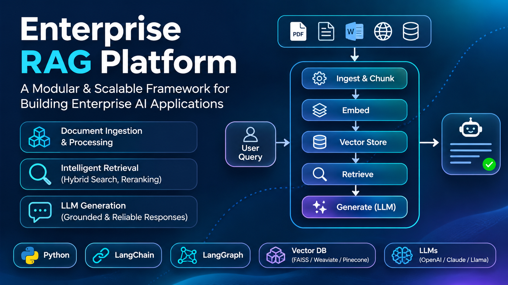

<div align="center">
  
</div>

<h1 align="center">Enterprise RAG Platform</h1>

<p align="center">An enterprise-grade Retrieval-Augmented Generation (RAG) architecture for investigating knowledge across heterogeneous enterprise sources.</p>


# Enterprise RAG Platform

> An enterprise-grade Retrieval-Augmented Generation (RAG) architecture for investigating knowledge across heterogeneous enterprise sources.

## Overview

`enterprise-rag-platform` is a reference implementation of an **Enterprise Knowledge Investigation Platform**.

The project explores how production-oriented RAG systems can retrieve, combine, validate, and present evidence from heterogeneous enterprise knowledge sources.

This is intentionally **not another "chat with documents" application**. The focus is architecture, extensibility, retrieval engineering, and controlled evolution from a working RAG implementation.

A representative investigation is:

> Why did payment timeout incidents increase after Release 2026.03, have similar incidents happened before, and what internal documentation explains the likely cause?

A future investigation flow is:

```text
User Question
      ↓
Query Understanding
      ↓
Query Transformation
      ↓
Retrieval Planning
      ↓
Knowledge Source Routing
      ↓
Retrieval
      ↓
Evidence Fusion
      ↓
Reranking
      ↓
Context Engineering
      ↓
LLM Generation
      ↓
Response Validation
      ↓
Citation & Attribution
      ↓
Enterprise Answer
```

---

# Architecture Principles

## 1. RAG Is a Retrieval Architecture

The project treats RAG as an enterprise retrieval and evidence architecture, not simply:

```text
Vector Database + LLM
```

The architecture owns concerns such as:

- Domain models
- Ports and contracts
- Selection policies
- Registries
- Retrieval planning
- Orchestration
- Evidence management
- Context construction
- Enterprise workflow

---

## 2. Own the Architecture, Reuse Mature Frameworks

We do **not reinvent mature RAG infrastructure**.

The core principle is:

> **Own the architectural contract; reuse mature frameworks for implementation primitives.**

Examples:

```text
Document loading
    → LangChain / LlamaIndex / native libraries

Chunking
    → LangChain / LlamaIndex

Embeddings
    → LangChain / provider SDK

Vector retrieval
    → LangChain integrations / vector database SDK

Reranking
    → Framework / provider implementation

ANN
    → FAISS / vector database

Graph
    → Graph database / framework

SQL
    → SQLAlchemy / database tooling
```

We build the architectural boundary and orchestration around these capabilities rather than reimplementing their underlying algorithms.

Framework-specific types should not leak into the domain model or core contracts.

---

## 3. Ports and Adapters

The architectural boundary is:

```text
Application
     ↓
Port / Contract
     ↓
Selector / Registry
     ↓
Adapter
     ↓
Framework / Provider
```

For example:

```text
Application
     ↓
LLMProvider
     ↓
LLM Adapter
     ↓
Ollama / Watsonx / other provider
```

The same pattern applies to loaders, chunkers, embeddings, retrievers, rerankers, vector stores, and other replaceable implementations.

---

# Inbound and Outbound Architecture

Inbound ports define what the application exposes. Outbound ports define what the application needs.

```text
REST Controller
       ↓
RAGUseCase              ← Inbound Port
       ↑
RAGService              ← Application implementation
       ↓
RAGWorkflow
       ↓
Outbound Ports
       ↓
Adapters
       ↓
Frameworks / Providers
```

`RAGService` implements the `RAGUseCase` inbound contract.

This also allows future inbound adapters to use the same application contract:

```text
REST Controller ──┐
Kafka Consumer ───┼──→ RAGUseCase → RAGService
CLI / Job ────────┘
```

---

# Project Structure

The agreed target architecture is:

```text
enterprise-rag-platform/
│
├── app/
│   ├── api/
│   │   ├── controllers/
│   │   ├── request/
│   │   └── response/
│   │
│   ├── application/
│   │   ├── services/
│   │   │   ├── rag_service.py
│   │   │   ├── ingestion_service.py
│   │   │   └── investigation_service.py
│   │   └── workflows/
│   │       └── rag_workflow.py
│   │
│   ├── domain/
│   │   ├── model/
│   │   ├── value_objects/
│   │   ├── enums/
│   │   └── exceptions/
│   │
│   ├── ports/
│   │   ├── inbound/
│   │   │   └── rag_use_case.py
│   │   └── outbound/
│   │       ├── llm_provider.py
│   │       ├── embedding_provider.py
│   │       ├── retriever.py
│   │       ├── reranker.py
│   │       ├── document_loader.py
│   │       ├── knowledge_source.py
│   │       ├── graph_provider.py
│   │       ├── sql_provider.py
│   │       └── cache.py
│   │
│   ├── retrieval/
│   │   ├── planning/
│   │   ├── transformation/
│   │   ├── retrievers/
│   │   ├── ranking/
│   │   └── context/
│   │
│   ├── knowledge/
│   │   ├── documents/
│   │   ├── structured/
│   │   ├── graph/
│   │   ├── multimodal/
│   │   └── routing/
│   │
│   ├── ai/
│   │   └── decision/
│   │       └── model_router.py
│   │
│   ├── validation/
│   ├── citation/
│   ├── reliability/
│   ├── evaluation/
│   ├── observability/
│   ├── security/
│   ├── governance/
│   │
│   ├── adapters/
│   │   ├── frameworks/
│   │   │   ├── langchain/
│   │   │   └── llamaindex/
│   │   ├── providers/
│   │   │   ├── llm/
│   │   │   ├── embeddings/
│   │   │   └── reranking/
│   │   └── persistence/
│   │       ├── vector/
│   │       ├── document/
│   │       └── cache/
│   │
│   └── ui/
│
├── tests/
├── experiments/
├── datasets/
├── docs/
├── infrastructure/
├── main.py
├── requirements.txt
├── .env.example
├── .gitignore
└── README.md
```

The target structure is architectural; files are implemented incrementally rather than all at once.

---

# Domain Foundation

The initial domain is framework-independent.

## Document

```python
@dataclass
class Document:
    id: DocumentId
    content: str
    metadata: dict[str, object]
```

Represents a source document independently LangChain, or LlamaIndex.

## DocumentChunk

```python
@dataclass
class DocumentChunk:
    id: str
    document_id: DocumentId
    content: str
    metadata: dict[str, object]
```

Represents a retrievable unit belonging to a document.

```text
Document
   │
   └── 1 → many ──→ DocumentChunk
```

## Evidence

```python
@dataclass
class Evidence:
    content: str
    document_id: str
    source: str
    metadata: dict[str, object]
    retrieval_score: float | None = None
```

Evidence represents information selected during retrieval for use in downstream RAG processing.

## DocumentId

```python
@dataclass(frozen=True)
class DocumentId:
    value: str
```

`DocumentId` is an immutable domain value object used by `Document` and `DocumentChunk`.

---

# Domain Enums

The initial domain vocabulary contains the strategies already established for the early implementation phases.

### QueryStrategy

```text
ORIGINAL
REWRITE
MULTI_QUERY
```

### RetrievalStrategy

```text
SEMANTIC
SPARSE
HYBRID
```

```

Future values are introduced when the corresponding capability is implemented.

---

# Application Layer

The application layer coordinates use cases without depending on framework implementations.

Current boundaries include:

```text
RAGService
IngestionService
InvestigationService
RAGWorkflow
```

The key relationship is:

```text
RAGUseCase
     ↑
     │ implements
RAGService
     ↓
RAGWorkflow
```

The application layer should not directly instantiate LangChain, Chroma, FAISS, or provider SDK classes.

---

# Provider and Framework Boundaries

Provider contracts live under:

```text
app/ports/outbound/
```

Concrete implementations live under:

```text
app/adapters/providers/
```

For example:

```text
app/ports/outbound/llm_provider.py
        ↓
app/adapters/providers/llm/
        ↓
Ollama / Watsonx / other providers
```

And:

```text
app/ports/outbound/embedding_provider.py
        ↓
app/adapters/providers/embeddings/
        ↓
Ollama / Watsonx / other providers
```

Framework-specific adapters live under:

```text
app/adapters/frameworks/
├── langchain/
└── llamaindex/
```

Factories such as `LLMFactory`, `EmbeddingFactory`, `RetrieverFactory`, and `RerankerFactory` will be introduced when multiple concrete implementations actually need to be selected. They are not created prematurely.

---

# Implementation Roadmap

The authoritative implementation sequence is:

```text
PHASE 0 — Skeleton + Foundation  Preparation
        ↓
PHASE 1 — Enterprise RAG Core
        ↓
PHASE 2 — Query & Retrieval Intelligence
        ↓
PHASE 3 — Advanced Retrieval Engineering
        ↓
REVIEW
```

## Phase 0 — Skeleton + Foundation

Phase 0 establishes:

- Repository structure
- Domain models
- Value objects
- Domain enums
- Domain exceptions
- Inbound and outbound ports
- Application services
- API boundaries
- Provider adapter boundaries
- Migration foundation
- Working baseline

No advanced retrieval is implemented in Phase 0.

## Phase 1 — Enterprise RAG Core

Target:

```text
Document Source
      ↓
Document Loader
      ↓
Document Processing
      ↓
Document Chunking
      ↓
Embedding
      ↓
Vector Store
      ↓
Retriever
      ↓
Evidence
      ↓
RAG Service
      ↓
LLM
      ↓
Response
```

Capabilities:

- Generic document loading
- Loader registry and selector
- LangChain loader adapters
- Generic document processing
- Document chunker port
- Chunker registry and selector
- LangChain splitter adapter
- Embeddings
- Chroma and FAISS
- Basic vector retriever
- Basic RAG service/workflow
- LLM providers
- Tests

Milestone:

```text
feat(rag): establish enterprise rag core
```

## Phase 2 — Query & Retrieval Intelligence

Target:

```text
User Query
    ↓
Query Analysis
    ↓
Query Transformation
    ↓
RetrievalPlan
    ↓
Retriever Selection
    ↓
Retriever
    ↓
Evidence
```

Capabilities include:

- Query transformer
- Rewrite
- Multi-query
- Retrieval strategy selection
- Retrieval planner
- RetrievalPlan
- Retriever selector
- Parent-document retrieval
- Self-query retrieval
- Updated RAG workflow
- Tests

Milestone:

```text
feat(retrieval): add query and retrieval intelligence
```

## Phase 3 — Advanced Retrieval Engineering

Target:

```text
Query
 ↓
Transformation
 ↓
Candidate Generation
 ↓
Multi-Signal Retrieval
 ↓
Fusion
 ↓
Reranking
 ↓
MMR / Recency
 ↓
Context Selection
 ↓
Context Budget
 ↓
Evidence
```

Capabilities include:

- Sparse/BM25 retrieval
- Hybrid retrieval
- Multi-signal retrieval
- Fusion
- Reranking
- Multi-vector retrieval
- MMR
- Recency-aware retrieval
- Contextual compression
- Context selection
- Context budget
- Retrieval experiments
- Tests and benchmarks

Milestone:

```text
feat(retrieval): add advanced retrieval engineering
```

---

# Deliberately Deferred

After Phase 3, stop and review the architecture.

Do not implement these before the review:

```text
Phase 4
├── Knowledge-source routing
├── Adaptive retrieval
├── Agentic retrieval
└── Advanced reliability

Phase 5
├── Graph RAG
├── SQL RAG
└── Multimodal RAG

Phase 6
├── LlamaIndex adapter
└── Vector infrastructure experiments

Phase 7+
├── Production context engineering
├── Grounding
├── Citation
├── Evaluation
├── Observability
├── Security
├── Governance
└── Production platform
```

LlamaIndex is intentionally introduced later to demonstrate framework implementation without framework lock-in.

---

# Development Discipline

For every capability:

```text
1. Create target skeleton
        ↓
2. Define / verify contract
        ↓
3. Identify reusable code
        ↓
4. Move it
        ↓
5. Generalize it
        ↓
6. Put framework-specific code behind adapter
        ↓
7. Wire selector / registry when needed
        ↓
8. Update application workflow
        ↓
9. Test
        ↓
10. Run existing behavior
        ↓
11. Add new capability
        ↓
12. Commit
```

This keeps architectural restructuring, framework migration, and feature development under control.

---

# Development Environment

The project uses Python.

Recommended:

```text
Python 3.12+
```

Create a virtual environment:

```bash
py -m venv .venv
```

Git Bash:

```bash
source .venv/Scripts/activate
```

Windows CMD:

```cmd
 .\.venv\Scripts\Activate.ps1
```

PowerShell:

```powershell
.venv\Scripts\Activate.ps1
```

---

# Install Dependencies

```bash
python -m pip install --upgrade pip
pip install -r requirements.txt
```

Configure environment variables:

```bash
cp .env.example .env
```

Do not commit `.env`.

---

# Compile / Syntax Verification

Python does not require a separate traditional compile step before execution.

To verify that the application source compiles:

```bash
python -m compileall app
```

For application and tests:

```bash
python -m compileall app tests
```

---

# Run Tests

Full suite:

```bash
pytest
```

Verbose:

```bash
pytest -v
```

Focused test:

```bash
pytest tests/path/to/test_file.py -v
```

---

# Run the Application

Current entry point:

```text
main.py
```

Run:

```bash
python main.py
```

If the current `main.py` exposes a FastAPI application as `app`, use:

```bash
uvicorn main:app --reload
```

The exact runtime command should follow the current `main.py` implementation.

---

# Code Quality

Run Ruff:

```bash
ruff check .
```

Format when appropriate:

```bash
ruff format .
```

Recommended verification sequence:

```bash
python -m compileall app tests
pytest
ruff check .
python main.py
```

---

# Tests, Experiments and Documentation

Tests:

```text
tests/
├── unit/
├── integration/
├── retrieval/
├── evaluation/
└── end_to_end/
```

Experiments:

```text
experiments/
├── retrieval/
├── reranking/
├── vector_search/
└── frameworks/
```

Documentation:

```text
docs/
├── architecture/
├── decisions/
├── retrieval/
└── operations/
```

Experiments remain separate from production-oriented application code.

---

# What This Project Is Not

This project is intentionally not:

- A generic "chat with PDF" application
- A single-vector-database chatbot
- A collection of unrelated RAG demos
- A framework-specific tutorial
- A replacement for enterprise systems of record

The goal is an extensible enterprise retrieval architecture.


---

# Author

**Mihir Jha**

AI • Backend • Cloud
